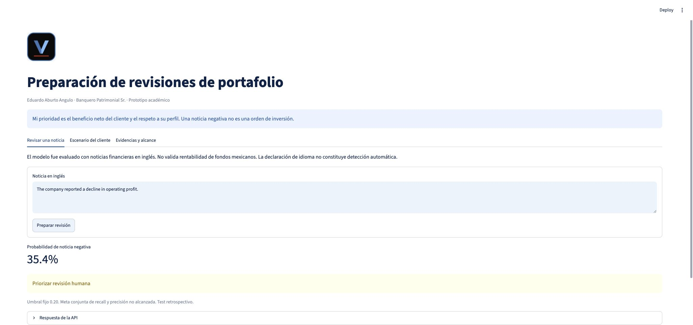
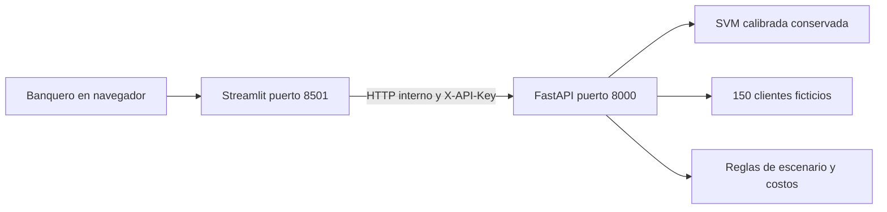

<p align="center"></p>

# Fase II · Del modelo a una aplicación integrada

**Asistente de preparación de revisiones de portafolio** · Eduardo Aburto Angulo · Módulo 2 / Semana 8

Como banquero Sr., quiero preparar revisiones mejor fundamentadas y cuidar el perfil del cliente. Esta entrega convierte el modelo de la Actividad 6 en una aplicación con **Streamlit + API + Docker**. Una alerta solicita revisión humana; no ordena comprar o vender ni promete mayor rentabilidad.

## Empieza aquí

| Quiero… | Abrir |
|---|---|
| Ejecutar la aplicación | [Inicio rápido](#inicio-rápido) |
| Entender el despliegue | [Manual paso a paso](documentos/Manual_despliegue.md) |
| Revisar los resultados reales | [Validación y pruebas](documentos/Validacion_pruebas.md) |
| Consultar la evidencia | [Carpeta de evidencias](evidencias/) y [ejecuciones automáticas](https://github.com/eduardoaburtoa/fase2-despliegue-portafolios/actions) |
| Revisar el modelo conservado | [Manifiesto e integridad](modelos/manifest.json) |
| Revisar el código | [API](backend/main.py) · [Streamlit](frontend/app.py) · [pruebas](pruebas/) |
| Entender los límites | [Aviso académico](AVISO.md) · [historial](CHANGELOG.md) |

## Entregables

| Documento | PDF | Word | Google editable |
|---|---|---|---|
| Manual de despliegue | [Leer](documentos/Manual_despliegue.pdf) | [Descargar](documentos/Manual_despliegue.docx) | [Editar en Google Docs](https://docs.google.com/document/d/1LV_KBLT7Qy7byvUB1MLYx707zmAkGK9t4W1OGwsUzeg/edit) |
| Validación y pruebas | [Leer](documentos/Validacion_pruebas.pdf) | [Descargar](documentos/Validacion_pruebas.docx) | [Editar en Google Docs](https://docs.google.com/document/d/1yTqjSho-RLJXCOgaJ0zn8dESHhs_sANzRZKyG5xz6cE/edit) |



**Verificado localmente:** 23 pruebas aprobadas, dos servicios saludables y 452 predicciones reproducidas con tolerancia de 10⁻¹².

## Qué podrás hacer

1. Analizar una noticia financiera **en inglés** y obtener su probabilidad de clase negativa.
2. Consultar 150 personajes ficticios con posiciones entre **$5 y $20 millones MXN**.
3. Simular una migración, sus costos y la compatibilidad del perfil, antes de llevarla a revisión humana.

Los personajes son un recurso didáctico para dar personalidad a los casos sin utilizar información real. No forman parte del entrenamiento del clasificador.

## Inicio rápido

Requisitos: Git, Docker Desktop abierto (Mac/Windows) o Docker Engine y Compose (Linux). Reserva 4 GB de memoria y espacio suficiente para la imagen. No necesitas GPU, Hugging Face ni credenciales de clientes.

```bash
git clone https://github.com/eduardoaburtoa/fase2-despliegue-portafolios.git
cd fase2-despliegue-portafolios
python3 -c "import secrets,pathlib; pathlib.Path('.env').write_text('API_TOKEN='+secrets.token_urlsafe(32)+'\n')"
docker compose up --build -d --wait --wait-timeout 180
```

Abre **http://localhost:8501** para Streamlit y **http://localhost:8000/docs** para la documentación de la API. El token permanece en `.env`, que Git ignora. Para llamar endpoints protegidos usa el encabezado `X-API-Key`; no publiques la clave.

```bash
docker compose ps
docker compose logs --tail 50
docker compose down
```

Los puertos están ligados a localhost. El manual propone acceso privado mediante túnel SSH en la nube; no hay un servicio público desplegado ni un cargo cloud generado por esta entrega.

## Arquitectura



Una misma imagen ejecuta dos servicios: `SERVICE=api` y `SERVICE=web`. Docker espera la salud de la API antes de abrir Streamlit. Los procesos usan usuario sin privilegios, filesystem de solo lectura y directorio temporal separado.

| Endpoint | Acceso | Función |
|---|---|---|
| GET /health | Sin clave | Estado del modelo |
| GET /v1/model | Con clave | Versión, hash, umbral y límites |
| POST /v1/predict | Con clave | Clasificación de noticia |
| GET /v1/clients | Con clave | Casos ficticios |
| POST /v1/scenario | Con clave | Compatibilidad y costos hipotéticos |

## Modelo y negocio

Se conserva SVM calibrada con **umbral 0.20**. Su tarea es detectar noticias negativas en Financial PhraseBank, no evaluar fondos mexicanos. El test histórico tiene 452 noticias; volver a ejecutar sus predicciones comprueba consistencia técnica, no generalización nueva. La meta conjunta de la Actividad 6 sigue sin alcanzarse.

El escenario supone **1 % por compra y 1 % por venta**, ambos sobre el mismo monto migrado. Sólo marca un caso como elegible para revisión cuando el perfil coincide y el beneficio incremental supuesto después de costos es positivo. La mejora de rendimiento la introduce el usuario como hipótesis; no la produce el modelo. No se incorporan impuestos ni capitalización. La elegibilidad no equivale a una recomendación.

Se conservan [61 fichas indexadas](contexto/fichas_bbva.csv) y [693 registros por serie](contexto/comisiones_por_serie.csv) de la actividad anterior, con corte del 22 de octubre de 2026. Antes de usar una comisión hay que comprobar vigencia, serie y periodicidad en la [fuente oficial BBVA](https://www.bbva.mx/personas/productos/inversion/normativa-de-fondos.html). No se presenta ese inventario como actualización de todas las fichas al 30 de octubre.

## Pruebas reproducibles

```bash
python3.12 -m venv .venv
source .venv/bin/activate
pip install -r requirements-dev.txt
python -m pytest pruebas -q --junitxml=evidencias/pytest-local.xml
set -a
source .env
set +a
TEST_ENV=docker_local python scripts/smoke.py
TEST_ENV=docker_local python scripts/regression_http.py
```

La suite cubre contrato, autenticación, entradas inválidas, vocabulario desconocido, costos, perfiles, fallos de conexión y las 452 predicciones congeladas. Las pruebas HTTP requieren ambos contenedores encendidos. Los resultados publicados se distinguen por entorno.

## Cobertura de la rúbrica

| Criterio · 25 % cada uno | Implementación y evidencia |
|---|---|
| Contenerización y ejecución local | [Dockerfile](Dockerfile), [Compose](compose.yaml), evidencia de salud e imagen en `evidencias/` |
| Integración frontend y backend | API, cliente HTTP de Streamlit, prueba de comunicación entre servicios |
| Pruebas completas y casos extremos | Suite `pruebas/`, regresión HTTP y documento de validación |
| Documentación y repositorio | Manual, validación, código organizado, configuración y este recorrido de lectura |

## Continuidad y licencia

[Actividad 4](https://github.com/eduardoaburtoa/motor-senales-nlp) · [Actividad 5](https://github.com/eduardoaburtoa/actividad5-mlflow-portafolios) · [Actividad 6](https://github.com/eduardoaburtoa/actividad6-evaluacion-portafolios)

Trabajo académico personal; no es un producto oficial de BBVA. Financial PhraseBank conserva su licencia **CC BY-NC-SA 3.0**, que limita uso comercial. Véase [AVISO](AVISO.md). La documentación se preparó con apoyo de ChatGPT/Codex y se contrasta con ejecuciones y archivos; no se atribuye uso de Copilot no realizado.
