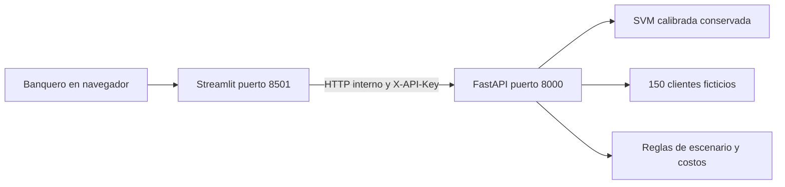

<p align="center"></p>

# Fase II · Del modelo a una aplicación integrada

**Asistente de preparación de revisiones de portafolio** · Eduardo Aburto Angulo · Módulo 2 / Semana 8

Como banquero Sr., quiero preparar revisiones mejor fundamentadas y cuidar el perfil del cliente. Esta entrega convierte el modelo de la Actividad 6 en una aplicación con **Streamlit + API + Docker**. Una alerta solicita revisión humana; no ordena comprar o vender ni promete mayor rentabilidad.

## Empieza aquí

| Quiero… | Abrir |
|---|---|
| Ejecutar la aplicación | [Inicio rápido](#inicio-rápido) |
| Analizar probabilidades y errores | [Análisis del modelo](documentos/Validacion_pruebas.md#análisis-del-comportamiento-del-modelo) · [JSON reproducible](evidencias/comportamiento_modelo.json) |
| Consultar el contrato API | [OpenAPI](documentos/openapi.json) · [Referencia HTML para descargar](documentos/api-reference.html) · [Cinco ejemplos ejecutados](evidencias/ejemplos_api.json) |
| Auditar la reproducción | [Pasos y tiempos](evidencias/replicabilidad.json) |
| Entender el despliegue | [Manual paso a paso](documentos/Manual_despliegue.md) |
| Revisar los resultados reales | [Validación y pruebas](documentos/Validacion_pruebas.md) |
| Consultar la evidencia | [Carpeta de evidencias](evidencias/) y [ejecuciones automáticas](https://github.com/eduardoaburtoa/fase2-despliegue-portafolios/actions) |
| Revisar el modelo conservado | [Manifiesto e integridad](modelos/manifest.json) |
| Revisar el código | [API](backend/main.py) · [Streamlit](frontend/app.py) · [pruebas](pruebas/) |
| Entender los límites | [Aviso académico](AVISO.md) · [historial](CHANGELOG.md) |

**Validación automática aprobada:** [ver ejecución de GitHub Actions](https://github.com/eduardoaburtoa/fase2-despliegue-portafolios/actions/runs/41163897429). Incluye pruebas, construcción Docker e integración HTTP.

## Entregables

| Documento | PDF | Word | Google editable |
|---|---|---|---|
| Manual de despliegue | [Leer](documentos/Manual_despliegue.pdf) | [Descargar](documentos/Manual_despliegue.docx) | [Editar en Google Docs](https://docs.google.com/document/d/1Xr2oBZBLeh-ZRx4wDzZ1xfWhC9lattDz5qfKKJPVlWA/edit) |
| Validación y pruebas | [Leer](documentos/Validacion_pruebas.pdf) | [Descargar](documentos/Validacion_pruebas.docx) | [Editar en Google Docs](https://docs.google.com/document/d/1v5b0XYiLvcQmZwQp8CwbwbKsOda9S5Wc3Vy8zFcjvt8/edit) |


**Verificado localmente:** 23 pruebas aprobadas, dos servicios saludables y 452 predicciones reproducidas con tolerancia de 10⁻¹².

## Qué podrás hacer

1. Analizar una noticia financiera **en inglés** y obtener su probabilidad de clase negativa.
2. Consultar 150 personajes ficticios con posiciones entre **$5 y $20 millones MXN**.
3. Simular una migración, sus costos y la compatibilidad del perfil, antes de llevarla a revisión humana.

Los personajes son un recurso didáctico para dar personalidad a los casos sin utilizar información real. No forman parte del entrenamiento del clasificador.

## Inicio rápido

Requisitos: Git, Docker Desktop abierto (Mac/Windows) o Docker Engine y Compose (Linux). Reserva 4 GB de memoria y espacio suficiente para la imagen. No necesitas GPU, Hugging Face ni credenciales de clientes.

```bash
git clone https://github.com/eduardoaburtoa/fase2-despliegue-portafolios.git
cd fase2-despliegue-portafolios
python3 -c "import secrets,pathlib; pathlib.Path('.env').write_text('API_TOKEN='+secrets.token_urlsafe(32)+'\n')"
docker compose up --build -d --wait --wait-timeout 180
```

Abre **http://localhost:8501** para Streamlit y **http://localhost:8000/docs** para la documentación de la API. El token permanece en `.env`, que Git ignora. Para llamar endpoints protegidos usa el encabezado `X-API-Key`; no publiques la clave.

```bash
docker compose ps
docker compose logs --tail 50
docker compose down
```

Los puertos están ligados a localhost. El manual propone acceso privado mediante túnel SSH en la nube; no hay un servicio público desplegado ni un cargo cloud generado por esta entrega.

## Arquitectura




Una misma imagen ejecuta dos servicios: `SERVICE=api` y `SERVICE=web`. Docker espera la salud de la API antes de abrir Streamlit. Los procesos usan usuario sin privilegios, filesystem de solo lectura y directorio temporal separado.

| Endpoint | Acceso | Función |
|---|---|---|
| GET /health | Sin clave | Estado del modelo |
| GET /v1/model | Con clave | Versión, hash, umbral y límites |
| POST /v1/predict | Con clave | Clasificación de noticia |
| GET /v1/clients | Con clave | Casos ficticios |
| POST /v1/scenario | Con clave | Compatibilidad y costos hipotéticos |

## Modelo y negocio

Se conserva SVM calibrada con **umbral 0.20**. Su tarea es detectar noticias negativas en Financial PhraseBank, no evaluar fondos mexicanos. El test histórico tiene 452 noticias; volver a ejecutar sus predicciones comprueba consistencia técnica, no generalización nueva. La meta conjunta de la Actividad 6 sigue sin alcanzarse.

El escenario supone **1 % por compra y 1 % por venta**, ambos sobre el mismo monto migrado. Sólo marca un caso como elegible para revisión cuando el perfil coincide y el beneficio incremental supuesto después de costos es positivo. La mejora de rendimiento la introduce el usuario como hipótesis; no la produce el modelo. No se incorporan impuestos ni capitalización. La elegibilidad no equivale a una recomendación.

Se conservan [61 fichas indexadas](contexto/fichas_bbva.csv) y [693 registros por serie](contexto/comisiones_por_serie.csv) de la actividad anterior, con corte del 22 de octubre de 2026. Antes de usar una comisión hay que comprobar vigencia, serie y periodicidad en la [fuente oficial BBVA](https://www.bbva.mx/personas/productos/inversion/normativa-de-fondos.html). No se presenta ese inventario como actualización de todas las fichas al 30 de octubre.

## Pruebas reproducibles

Mantén Docker encendido durante las comprobaciones HTTP; ejecuta `docker compose down` al terminar todas las pruebas, no antes. Para recrear el histograma instala además `matplotlib==3.10.3` y ejecuta `python scripts/analyze_behavior.py`. Este análisis no cambia el modelo.

```bash
python3.12 -m venv .venv
source .venv/bin/activate
pip install -r requirements-dev.txt
python -m pytest pruebas -q --junitxml=evidencias/pytest-local.xml
set -a
source .env
set +a
TEST_ENV=docker_local python scripts/smoke.py
TEST_ENV=docker_local python scripts/regression_http.py
```

La suite cubre contrato, autenticación, entradas inválidas, vocabulario desconocido, costos, perfiles, fallos de conexión y las 452 predicciones congeladas. Las pruebas HTTP requieren ambos contenedores encendidos. Los resultados publicados se distinguen por entorno.

## Cobertura de la rúbrica

| Criterio · 25 % cada uno | Implementación y evidencia |
|---|---|
| Contenerización y ejecución local | [Dockerfile](Dockerfile), [Compose](compose.yaml), evidencia de salud e imagen en `evidencias/` |
| Integración frontend y backend | API, cliente HTTP de Streamlit, prueba de comunicación entre servicios |
| Pruebas completas y casos extremos | Suite `pruebas/`, regresión HTTP y documento de validación |
| Documentación y repositorio | Manual, validación, código organizado, configuración y este recorrido de lectura |

## Continuidad y licencia

[Actividad 4](https://github.com/eduardoaburtoa/motor-senales-nlp) · [Actividad 5](https://github.com/eduardoaburtoa/actividad5-mlflow-portafolios) · [Actividad 6](https://github.com/eduardoaburtoa/actividad6-evaluacion-portafolios)

Trabajo académico personal; no es un producto oficial de BBVA. Financial PhraseBank conserva su licencia **CC BY-NC-SA 3.0**, que limita uso comercial. Véase [AVISO](AVISO.md). La documentación se preparó con apoyo de ChatGPT/Codex y se contrasta con ejecuciones y archivos; no se atribuye uso de Copilot no realizado.

## Continuidad del proyecto

Mi proyecto parte del motor de señales de rotación de fondos de inversión con IA para banca patrimonial, privada y casa de bolsa. La Actividad 4 comparó modelos preentrenados de Hugging Face para leer notas de mercado; la Actividad 5 registró el entrenamiento en MLflow; la Actividad 6 evaluó la SVM calibrada con umbral 0.20. La Fase I construyó el business case y esta Fase II convierte el modelo conservado en una aplicación integrada y desplegable.

Conservo las cifras de mi business case sin recalcularlas: alcance de 24 asesores por 150 clientes, 3,600 clientes y AUM simulado de $54,397 millones; inversión del piloto de $9,083,448 en los meses 1 a 9 con seis asesores; operación anual de $4,769,996. El beneficio esperado a pleno funcionamiento es $40,540,443 al año, con ROI a tres años de 298.6 % y recuperación en el mes 13; el escenario conservador plantea 38.8 % y mes 25 (Aburto Angulo, 2026).

La razón económica del proyecto es que, bajo aquellos supuestos, los clientes pagarían $79.65 millones de corretaje y conservarían $82.72 millones de rendimiento adicional: $1.04 por cada peso de corretaje. El umbral de rotación planteado es una mejora de 3.0 puntos porcentuales frente al costo supuesto de 2 %. Los supuestos críticos son S-14, detección actual de 30 %; S-15, aceptación de 70 %; y S-16, seis rotaciones no justificadas al año. Son hipótesis del caso de negocio, no resultados de esta aplicación.

Materializo la lectura de noticias con PLN y un escenario que calcula el costo didáctico del 2 % y la compatibilidad del perfil antes de proponer una revisión. Quedan para Fase III la proyección de rendimiento por clase de activo, la combinación de señales con el umbral financiero de 3.0 puntos, la integración con órdenes y el tablero de KPI. El umbral financiero de 3.0 puntos no debe confundirse con la probabilidad 0.20 del clasificador.

El riesgo R-01 es el conflicto de interés: la institución gana cuando el cliente se mueve. El control previsto exige suspender y recalibrar el motor si más de 25 % de las rotaciones recomendadas no supera su costo a doce meses. Este control todavía no está automatizado. La Fase II acredita que la arquitectura funciona, no que el ROI de 298.6 % se vaya a materializar; eso se mide en el piloto de nueve meses. La IA no sustituye el criterio del banquero; lo aumenta.


## Cierre de revisión 1.1.0

Consulta el [estado de las brechas A–G](documentos/Cierre_brechas.md) y la [bitácora reproducible de Ubuntu](documentos/Reproduccion_Ubuntu.md). Ambos documentos de Google abren sin iniciar sesión; el propietario conserva la edición. La captura nueva de Swagger continúa pendiente por una restricción del navegador; no se sustituye con una imagen simulada.
