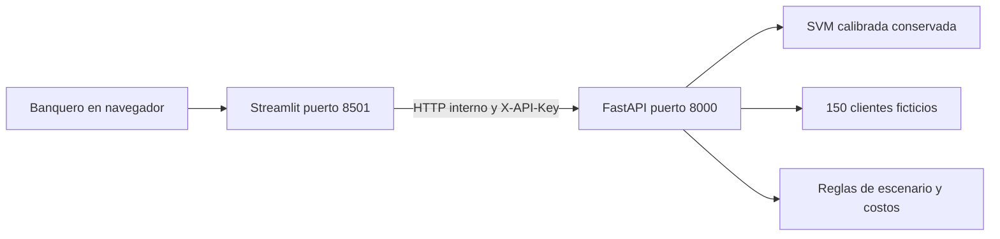

<p align="center"></p>

# Fase II · Del modelo a una aplicación integrada

**Asistente de preparación de revisiones de portafolio** · Eduardo Aburto Angulo · Módulo 2 / Semana 8

Como banquero Sr., quiero preparar revisiones mejor fundamentadas y cuidar el perfil del cliente. Esta entrega convierte el modelo de la Actividad 6 en una aplicación con **Streamlit + API + Docker**. Una alerta solicita revisión humana; no ordena comprar o vender ni promete mayor rentabilidad.

## Recorrido de evaluación · los cuatro criterios

En esta fase no vuelvo a entrenar: despliego y valido el modelo conservado. El entregable es código ejecutable con Docker y evidencia de integración; no se exige notebook de Colab. Los resultados enlazados provienen de ejecuciones realizadas, no de celdas vacías ni de comandos pendientes.

| Criterio | Qué revisar primero | Evidencia ejecutada |
|---|---|---|
| Contenerización y despliegue local | [Dockerfile](Dockerfile) y [Compose](compose.yaml) | [Servicios healthy](evidencias/docker-compose-ps.txt) · [reproducción limpia](evidencias/replicabilidad.json) |
| Integración técnica | [Arquitectura](evidencias/arquitectura.png) y [contrato API](documentos/openapi.json) | [Cinco peticiones y respuestas](evidencias/ejemplos_api.json) · [integración HTTP](evidencias/smoke_ubuntu_limpio.json) |
| Pruebas y validación | [Casos extremos y análisis](documentos/Validacion_pruebas.md) | [23 pruebas](evidencias/pytest-ubuntu-limpio.xml) · [452 predicciones](evidencias/regresion_ubuntu_limpio.json) |
| Documentación y repositorio | [Manual PDF](documentos/Manual_despliegue.pdf) y [validación PDF](documentos/Validacion_pruebas.pdf) | [Comandos completos](documentos/Cierre_brechas.md#reproducir-la-validación-local) · [bitácora con fallos y correcciones](documentos/Reproduccion_Ubuntu.md) |

## Empieza aquí

| Quiero… | Abrir |
|---|---|
| Ejecutar la aplicación | [Inicio rápido](#inicio-rápido) |
| Analizar probabilidades y errores | [Análisis del modelo](documentos/Validacion_pruebas.md#análisis-del-comportamiento-del-modelo) · [JSON reproducible](evidencias/comportamiento_modelo.json) |
| Consultar el contrato API | [OpenAPI](documentos/openapi.json) · [Referencia HTML para descargar](documentos/api-reference.html) · [Cinco ejemplos ejecutados](evidencias/ejemplos_api.json) |
| Auditar la reproducción | [Pasos y tiempos](evidencias/replicabilidad.json) |
| Entender el despliegue | [Manual paso a paso](documentos/Manual_despliegue.md) |
| Revisar los resultados reales | [Validación y pruebas](documentos/Validacion_pruebas.md) |
| Consultar la evidencia | [Carpeta de evidencias](evidencias/) y [ejecuciones automáticas](https://github.com/eduardoaburtoa/fase2-despliegue-portafolios/actions) |
| Revisar el modelo conservado | [Manifiesto e integridad](modelos/manifest.json) |
| Revisar el código | [API](backend/main.py) · [Streamlit](frontend/app.py) · [pruebas](pruebas/) |
| Entender los límites | [Aviso académico](AVISO.md) · [historial](CHANGELOG.md) |

**Validación automática aprobada:** [ver ejecución de GitHub Actions](https://github.com/eduardoaburtoa/fase2-despliegue-portafolios/actions/runs/41216657020). Incluye pruebas, construcción Docker e integración HTTP.

## Entregables

| Documento | PDF | Word | Google editable |
|---|---|---|---|
| Manual de despliegue | [Leer](documentos/Manual_despliegue.pdf) | [Descargar](documentos/Manual_despliegue.docx) | [Editar en Google Docs](https://docs.google.com/document/d/1Xr2oBZBLeh-ZRx4wDzZ1xfWhC9lattDz5qfKKJPVlWA/edit) |
| Validación y pruebas | [Leer](documentos/Validacion_pruebas.pdf) | [Descargar](documentos/Validacion_pruebas.docx) | [Editar en Google Docs](https://docs.google.com/document/d/1v5b0XYiLvcQmZwQp8CwbwbKsOda9S5Wc3Vy8zFcjvt8/edit) |

**Verificado localmente:** 23 pruebas aprobadas, dos servicios saludables y 452 predicciones reproducidas con tolerancia de 10⁻¹².

## Resultados visibles, con interpretación


De las 61 noticias negativas, 51 activan alerta y 10 se omiten. Otras 25 noticias no negativas activan una alerta incorrecta. Por eso interpreto la salida como priorización de revisión humana. Conservo el umbral 0.20: este análisis retrospectivo no se usa para ajustarlo.

El [anexo de análisis visual](documentos/Analisis_visual.md) reúne probabilidades, longitud por clase y ejemplos concretos de errores. Cada gráfica tiene datos fuente y un procedimiento reproducible. La [captura de Streamlit](evidencias/streamlit-docker.png) acredita la interfaz; el escenario comercial se consulta como complemento.

## Inicio rápido

Requisitos: Git, Docker Desktop abierto (Mac/Windows) o Docker Engine y Compose (Linux). Reserva 4 GB de memoria y espacio suficiente para la imagen. No necesitas GPU, Hugging Face ni credenciales de clientes.

```bash
git clone https://github.com/eduardoaburtoa/fase2-despliegue-portafolios.git
cd fase2-despliegue-portafolios
python3 -c "import secrets,pathlib; pathlib.Path('.env').write_text('API_TOKEN='+secrets.token_urlsafe(32)+'\n')"
docker compose up --build -d --wait --wait-timeout 180
```

Abre **http://localhost:8501** para Streamlit y **http://localhost:8000/docs** para la documentación de la API. El token permanece en `.env`, que Git ignora. Para llamar endpoints protegidos usa el encabezado `X-API-Key`; no publiques la clave.

```bash
docker compose ps
docker compose logs --tail 50
docker compose down
```

Los puertos están ligados a localhost. El manual propone acceso privado mediante túnel SSH en la nube; no hay un servicio público desplegado ni un cargo cloud generado por esta entrega.

## Arquitectura




Una misma imagen ejecuta dos servicios: `SERVICE=api` y `SERVICE=web`. Docker espera la salud de la API antes de abrir Streamlit. Los procesos usan usuario sin privilegios, filesystem de solo lectura y directorio temporal separado.

| Endpoint | Acceso | Función |
|---|---|---|
| GET /health | Sin clave | Estado del modelo |
| GET /v1/model | Con clave | Versión, hash, umbral y límites |
| POST /v1/predict | Con clave | Clasificación de noticia |
| GET /v1/clients | Con clave | Casos ficticios |
| POST /v1/scenario | Con clave | Compatibilidad y costos hipotéticos |

## Modelo conservado y límites

Se conserva SVM calibrada con **umbral 0.20**. Su tarea es detectar noticias negativas en Financial PhraseBank, no evaluar fondos mexicanos. El test histórico tiene 452 noticias; volver a ejecutar sus predicciones comprueba consistencia técnica, no generalización nueva. La meta conjunta de la Actividad 6 sigue sin alcanzarse.

## Pruebas reproducibles

Mantén Docker encendido durante las comprobaciones HTTP; ejecuta `docker compose down` al terminar todas las pruebas, no antes. Para recrear el histograma instala además `matplotlib==3.10.3` y ejecuta `python scripts/analyze_behavior.py`. Este análisis no cambia el modelo.

```bash
python3.12 -m venv .venv
source .venv/bin/activate
pip install -r requirements-dev.txt
python -m pytest pruebas -q --junitxml=evidencias/pytest-local.xml
set -a
source .env
set +a
TEST_ENV=docker_local python scripts/smoke.py
TEST_ENV=docker_local python scripts/regression_http.py
```

La suite cubre contrato, autenticación, entradas inválidas, vocabulario desconocido, costos, perfiles, fallos de conexión y las 452 predicciones congeladas. Las pruebas HTTP requieren ambos contenedores encendidos. Los resultados publicados se distinguen por entorno.

## Cobertura de la rúbrica

| Criterio · 25 % cada uno | Implementación y evidencia |
|---|---|
| Contenerización y ejecución local | [Dockerfile](Dockerfile), [Compose](compose.yaml), evidencia de salud e imagen en `evidencias/` |
| Integración frontend y backend | API, cliente HTTP de Streamlit, prueba de comunicación entre servicios |
| Pruebas completas y casos extremos | Suite `pruebas/`, regresión HTTP y documento de validación |
| Documentación y repositorio | Manual, validación, código organizado, configuración y este recorrido de lectura |

## Continuidad y licencia

[Actividad 4](https://github.com/eduardoaburtoa/motor-senales-nlp) · [Actividad 5](https://github.com/eduardoaburtoa/actividad5-mlflow-portafolios) · [Actividad 6](https://github.com/eduardoaburtoa/actividad6-evaluacion-portafolios)

Trabajo académico personal; no es un producto oficial de BBVA. Financial PhraseBank conserva su licencia **CC BY-NC-SA 3.0**, que limita uso comercial. Véase [AVISO](AVISO.md). La documentación se preparó con apoyo de ChatGPT/Codex y se contrasta con ejecuciones y archivos; no se atribuye uso de Copilot no realizado.

## Continuidad del proyecto

Fase I aporta el business case; las actividades 4, 5 y 6 aportan selección, entrenamiento y validación. En esta entrega demuestro la contenerización, integración y reproducción del modelo conservado. El [anexo de contexto del proyecto](documentos/Contexto_proyecto.md) conserva las cifras, los clientes ficticios, los supuestos de costos y los pendientes de Fase III. Son contexto complementario; no demuestran rendimiento de inversión ni sustituyen las pruebas técnicas.

## Cierre de revisión 1.1.0

Consulta el [estado de las brechas A–G](documentos/Cierre_brechas.md) y la [bitácora reproducible de Ubuntu](documentos/Reproduccion_Ubuntu.md). Ambos documentos de Google abren sin iniciar sesión; el propietario conserva la edición. La captura nueva de Swagger continúa pendiente por una restricción del navegador; no se sustituye con una imagen simulada.
