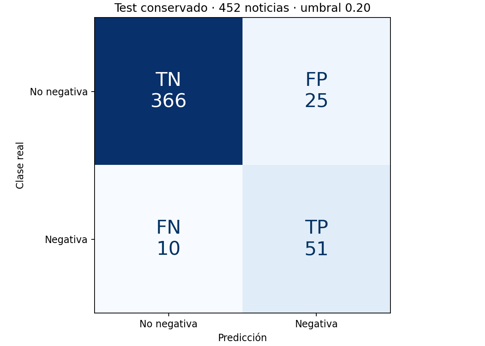
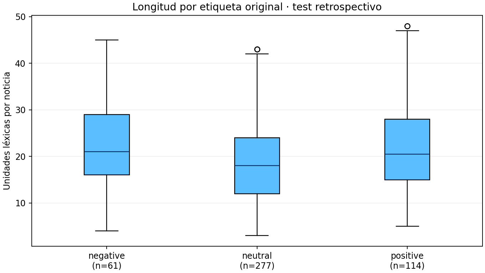

# Validación y pruebas de Fase II

Eduardo Aburto Angulo · 31 de octubre de 2026 · Versión 1.1.0

## Resumen y alcance

Comprobé que la API y Streamlit se comunican dentro de Docker y que el modelo conserva las predicciones históricas. La suite automatizada aprobó 23 pruebas; la regresión HTTP recorrió 452 noticias y obtuvo una diferencia máxima de 2.78 × 10⁻¹⁶ respecto al archivo de referencia, menor que la tolerancia de 10⁻¹². Ambos servicios alcanzaron estado healthy.

Esta conclusión acredita la integración y consistencia técnica del prototipo local. No equivale a una validación financiera, una prueba de carga ni un despliegue cloud completado. Como banquero Sr., mantengo la revisión humana: una alerta negativa no demuestra que migrar un fondo mejore el rendimiento.

## Arquitectura e integración

Figura 1. Arquitectura de la solución: navegador, Streamlit, FastAPI y modelo conservado.

La Figura 1 ubica los componentes que valido. El [manual, sección Arquitectura e integración](Manual_despliegue.md#arquitectura-e-integración), conserva la secuencia completa, la autenticación, los errores y los cinco ejemplos ejecutados. El hash se verifica al arrancar, no en cada noticia; las respuestas no autorizan operaciones. Esta tabla delimita las rutas sometidas a prueba:

Tabla 1. Ruta y resultados de validación.

| Ruta | Acceso y comprobación |
|---|---|
| GET /health | Pública: salud y disponibilidad del modelo |
| GET /v1/model | Con clave: identidad y límites del artefacto |
| POST /v1/predict | Con clave: validación, probabilidad y aviso |
| GET /v1/clients | Con clave: lectura de los 150 casos ficticios |
| POST /v1/scenario | Con clave: perfil, costos y elegibilidad hipotética |

## Modelo y datos conservados

Uso SVM calibrada con umbral 0.20, procedente de la Actividad 6. El hash SHA256 del archivo es f48c7496d5a12bd15d535721e3e83c6ef895b1ae7eaccbe7f4f4c60705bb1916. La API verifica esa identidad al arrancar. No reentrené ni elegí un nuevo umbral sobre las noticias de prueba.

El conjunto retrospectivo contiene 452 noticias en inglés: 61 negativas y 391 no negativas. El resultado binario positivo es noticia negativa. El vocabulario TF-IDF y el modelo se cargan del artefacto validado; no se ajustan a lo que el usuario escribe. El control de idioma depende de la declaración en; no es un detector de idioma. Si no hay ningún término conocido, la API rechaza el texto.

Los 150 personajes de contexto no entrenan el modelo. Sus posiciones entre 5 y 20 millones MXN y perfiles Conservador, Moderado y Agresivo son simulados. El motor de escenarios calcula hipótesis lineales y las mantiene separadas de la inferencia de noticias.

## Entorno y protocolo

La aplicación se probó primero en Python 3.12 y después en Docker Desktop, con contenedores Linux ARM64 en el Mac local. Se conserva la imagen y sus metadatos en evidencias/docker-image-local.json. El Dockerfile instala las versiones directas de requirements.txt; la imagen es la unidad exacta ejecutada. Una reconstrucción futura puede resolver otras dependencias transitivas; por ello se registra también el entorno instalado.

Las pruebas de contrato usan FastAPI TestClient. La prueba adicional scripts/smoke.py utiliza HTTP real. scripts/regression_http.py envía las 452 noticias al puerto publicado del contenedor y compara sus probabilidades. Finalmente, el cliente de Streamlit se ejecuta dentro del contenedor web para consultar api:8000; eso comprueba la resolución de servicio, red y credencial entre componentes.

## Casos funcionales y extremos

Tabla 2. Grupo y resultados de validación.

| Grupo | Entrada o condición | Resultado esperado y observado |
|---|---|---|
| Disponibilidad | Modelo cargado y /health | HTTP 200 y model_ready verdadero |
| Contrato | OpenAPI y manifiesto | Rutas disponibles, umbral e identidad conservados |
| Autenticación | Clave ausente o incorrecta | HTTP 401 |
| Texto | Vacío, espacios, números, nulo o más de 4000 caracteres | HTTP 422 |
| Esquema | Idioma es o campo desconocido | HTTP 422 |
| Vocabulario | Texto sin términos conocidos | HTTP 422, sin predicción fiable |
| Regresión | Las 452 noticias congeladas | Probabilidades dentro de tolerancia 10⁻¹² |
| Contexto | Consulta de clientes | 150 ficticios, posiciones dentro de los límites |
| Escenario | Perfil compatible y beneficio neto positivo | Elegible sólo para revisión humana |
| Protección de perfil | Perfil diferente | No elegible |
| Costos | Beneficio insuficiente tras gastos | No elegible |
| Límites numéricos | Proporción cero o mayor que uno, meses cero o fraccionarios, gastos negativos | HTTP 422 |
| Identidad | Cliente simulado inexistente | HTTP 404 |
| Configuración | Arranque sin clave suficiente | Arranque rechazado |
| Fallo de red | Backend no disponible | Mensaje comprensible en Streamlit |

La ejecución local aprobó 23 pruebas. Son 23 casos de pytest, no 452 casos adicionales de pytest: una de las pruebas recorre todo el test histórico. El informe JUnit conserva el detalle. Se observó una advertencia de deprecación de Starlette sobre TestClient y httpx; no produjo un fallo, pero se registra como deuda de actualización antes de futuras versiones.

Durante la inspección del navegador detecté que una expresión condicional de Streamlit mostraba la descripción interna de un objeto. La sustituí por un bloque if/else, reconstruí la imagen y repetí la interacción. La probabilidad y la alerta permanecieron correctas y desapareció el texto técnico innecesario.

## Resultados del modelo dentro de Docker

Tabla 3. Métrica y resultados de validación.

| Métrica | Resultado |
|---|---|
| Verdaderos negativos | 366 |
| Falsos positivos | 25 |
| Falsos negativos | 10 |
| Verdaderos positivos | 51 |
| Accuracy | 0.9226 |
| Precisión | 0.6711 |
| Recall | 0.8361 |
| F1 | 0.7445 |
| ROC AUC | 0.9548 |

Se generan 76 alertas: 51 noticias negativas recuperadas y 25 falsas alertas. Persisten 10 omisiones. La meta conjunta de recall y precisión de Actividad 6 no se alcanza. Empaquetar el modelo en Docker no elimina esa limitación ni demuestra generalización a noticias mexicanas.

La regresión HTTP inicial tardó aproximadamente 1.32 segundos para las 452 solicitudes secuenciales en este equipo. Es una observación de comprobación, no un SLA, percentil de latencia, prueba concurrente ni comparación válida de proveedores cloud.

## Análisis del comportamiento del modelo

La Figura 2 muestra qué errores produce el modelo en el test conservado.

Figura 2. Matriz de confusión de 452 noticias con umbral 0.20.

De las 61 noticias negativas, 51 activan alerta y 10 se omiten. Las otras 25 alertas corresponden a noticias no negativas. La clase positiva del clasificador significa noticia negativa; no es una valoración de rentabilidad. El umbral no se modifica con estos resultados retrospectivos.

La Figura 3 permite revisar la concentración de probabilidades alrededor del umbral.

Figura 3. Distribución retrospectiva de probabilidades en las 452 noticias conservadas.

Defino cerca del umbral como la banda descriptiva de 0.19 a 0.21, inclusive: contiene 5 noticias. No es un intervalo de confianza. En la frontera, una variación pequeña de puntuación puede cambiar la prioridad de lectura sin que cambie el riesgo económico del cliente. Por ello no uso la alerta como instrucción de inversión. El histograma y los conteos se regeneran con scripts/analyze_behavior.py y quedan respaldados por evidencias/comportamiento_modelo.json, que identifica el CSV mediante SHA256.

Tabla 4. Umbral exploratorio y resultados de validación.

| Umbral exploratorio | Alertas | Cambios frente a 0.20 | FP | FN |
|---|---|---|---|---|
| 0.19 | 78 | 2 | 27 | 10 |
| 0.20 operativo | 76 | 0 | 25 | 10 |
| 0.21 | 73 | 3 | 22 | 10 |

Bajar a 0.19 agrega dos falsas alertas; subir a 0.21 retira tres falsas alertas en este conjunto. Ninguna de las dos alternativas recupera los diez falsos negativos. Es un diagnóstico retrospectivo, no una selección válida de un nuevo umbral: mantengo 0.20 y reservo cualquier decisión futura para validación independiente.

La Figura 4 compara longitudes por etiqueta original; las tres clases conservan rangos solapados.

Figura 4. Longitud de las noticias por etiqueta original en el test retrospectivo.

Las medianas son 21 unidades léxicas para las 61 noticias negativas, 18 para las 277 neutrales y 20.5 para las 114 positivas. Los rangos respectivos son 4–45, 3–43 y 5–48. Cuento coincidencias de `\b\w+\b`, no tokens del modelo. Las cajas abarcan el rango intercuartílico; los bigotes usan 1.5 veces ese rango y los puntos exteriores se conservan. La longitud sola no separa clases ni explica causalmente los errores. Fuente: scripts/visualize_validation.py y evidencias/analisis_visual.json.

### Lectura de errores concretos

Seleccioné los primeros tres errores de cada tipo en el orden del CSV, sin presentarlos como una muestra aleatoria ni una explicación causal del modelo. Los textos originales completos están en el JSON de evidencia; aquí resumo su contenido (Malo et al., 2014).

Tabla 5. Caso y resultados de validación.

| Caso | Probabilidad | Lectura del texto y consecuencia operativa |
|---|---|---|
| FN FPB0374 | 0.0481 | Descenso de inventarios de pulpa en Norteamérica. El corpus lo etiqueta negativo; el significado económico depende del contexto sectorial. La ausencia de alerta no descarta un cambio relevante. |
| FN FPB0382 | 0.0422 | Flujo operativo en mínimo de ocho años. Omite un deterioro financiero explícito que yo sí revisaría al preparar una reunión. |
| FN FPB2012 | 0.0456 | Incertidumbres que afectan la perspectiva de largo plazo. La formulación breve no activa la alerta; necesito contexto adicional. |
| FP FPB0056 | 0.2150 | Expectativa de crecimiento de ventas y retorno a beneficios. La alerta contradice la etiqueta positiva y genera trabajo de revisión innecesario. |
| FP FPB0203 | 0.2392 | Aumento de utilidad neta de 15 %. La clasificación negativa no equivale a deterioro del emisor. |
| FP FPB0331 | 0.3571 | Reducción de la pérdida frente al año previo. Sigue mencionando una pérdida, pero el corpus valora la mejora; el contexto comparativo importa. |

Estas lecturas describen el contenido observado; no demuestran qué palabras causaron cada decisión. El análisis no sustituye una explicación formal del estimador.

### Rechazo y tiempos de respuesta

Cuando ninguno de los vocabularios TF-IDF de los tres calibradores reconoce términos, la API devuelve HTTP 422 en lugar de una probabilidad. Evito así presentar una salida sin soporte léxico como si fuera evidencia para el banquero. El rechazo exige lectura humana; no significa que la noticia sea neutral. Tampoco valida el idioma: declarar en sigue siendo responsabilidad del usuario.

La evidencia original de Docker registra 1.321524792 segundos para 452 solicitudes secuenciales: 2.923727 ms por solicitud como promedio amortizado del recorrido. Incluye el trabajo del cliente y del bucle; no se guardaron duraciones individuales y no puedo atribuir percentiles ni un máximo por petición. No es un SLA ni una prueba de carga.

Como banquero Sr., confío en esta capa para ordenar una lectura inicial, siempre que la noticia esté dentro del alcance en inglés. No confío en la ausencia de alerta para descartar deterioro ni en una alerta para justificar una migración. Los diez falsos negativos y las veinticinco falsas alertas explican por qué conservo supervisión humana y por qué la meta conjunta sigue sin alcanzarse.

## Comportamiento por segmentos

Definí tres tramos fijos de longitud: 1–15, 16–30 y 31 o más unidades léxicas (`\b\w+\b`). Son descripciones del test; no se eligieron para maximizar métricas. Precisión es acierto entre alertas; recall es detección entre noticias realmente negativas. Un denominador cero se informa como no definido.

Tabla 6. Longitud y resultados de validación.

| Longitud | n | Negativas | Precisión | Recall | FP | FN | Errores |
|---|---:|---:|---:|---:|---:|---:|---:|
| 1–15 | 158 | 15 | 58.82 % | 66.67 % | 7 | 5 | 12 |
| 16–30 | 228 | 32 | 69.77 % | 93.75 % | 13 | 2 | 15 |
| 31 o más | 66 | 14 | 68.75 % | 78.57 % | 5 | 3 | 8 |

No interpreto las diferencias entre tramos como significativas: sus tamaños y números de negativas varían. Uso esta lectura para identificar dónde revisar errores, no para cambiar el modelo con el test.

### Franjas operativas

Los extremos inferiores son inclusivos y los superiores exclusivos, salvo 1.00. La fracción negativa observada es una frecuencia retrospectiva, no una probabilidad garantizada para una noticia futura.

Tabla 7. Probabilidad y resultados de validación.

| Probabilidad | Noticias | Negativas reales | Fracción negativa | Acción de revisión humana |
|---|---:|---:|---:|---|
| [0, 0.10) | 349 | 9 | 2.58 % | No priorizo sólo por esta salida; leo el contexto y mantengo controles humanos. |
| [0.10, 0.20) | 27 | 1 | 3.70 % | Reviso el contexto si hay otros indicios; no altero el umbral ni descarto riesgo. |
| [0.20, 0.50) | 29 | 11 | 37.93 % | Prioriza lectura humana; contrasto la noticia con la fuente antes de cualquier decisión. |
| [0.50, 1] | 47 | 40 | 85.11 % | Prioriza lectura humana; una probabilidad alta tampoco autoriza una orden ni garantiza acierto. |

### Consistencia entre entornos

La matriz se presenta como TN, FP, FN, TP. Cada tiempo corresponde a una corrida de 452 solicitudes en su entorno; no comparo velocidad sin igualar hardware, carga y protocolo.

Tabla 8. Entorno y resultados de validación.

| Entorno | Error absoluto máximo | Matriz TN FP FN TP | Tiempo total s | Evidencia |
|---|---:|---|---:|---|
| host_local_sin_docker | 1.11022e-16 | 366, 25, 10, 51 | 0.776614 | evidencias/regresion_host_local_sin_docker.json |
| docker_local | 2.77556e-16 | 366, 25, 10, 51 | 1.321525 | evidencias/regresion_docker_local.json |
| docker_ci | No medido | No disponible | No medido | sin medición completa disponible |
| ubuntu_limpio | 2.77556e-16 | 366, 25, 10, 51 | 0.866663 | evidencias/regresion_ubuntu_limpio.json |

Como banquero, confío en que la aplicación reproduce el artefacto evaluado; no convierto esa consistencia en confianza ciega sobre cada noticia. Reviso también las alertas con probabilidad alta y no considero una probabilidad baja como ausencia de riesgo. La IA no sustituye el criterio del banquero; lo aumenta. Fuente reproducible: scripts/analyze_segments.py y evidencias/analisis_segmentos.json.

## Escenario económico y controles

Para C001, con posición de $11,858,000, migrar 35 % supone $4,150,300. Una mejora anual hipotética de 3 puntos a 12 meses representa $124,509; el corretaje supuesto del 2 % asciende a $83,006 y deja $41,503 antes de impuestos y otros gastos. El ejemplo sólo puede marcarse elegible para revisión si el destino conserva el perfil Moderado y el beneficio neto supuesto es positivo.

El 1 % por compra y 1 % por venta no se presenta como tarifa general de BBVA. El índice de fondos heredado tiene corte al 22 de octubre de 2026; hay que confirmar cada serie, periodicidad y vigencia en el original. Las comisiones de fondos no equivalen al ingreso neto del banco. Si el rendimiento introducido ya es neto, no descuento de nuevo el mismo gasto.

## Evidencia y criterios de aceptación

Tabla 9. Criterio de la rúbrica y resultados de validación.

| Criterio de la rúbrica | Evidencia verificable |
|---|---|
| Docker y ejecución local, 25 % | Dockerfile, compose.yaml, estado healthy, ID y arquitectura de imagen |
| Integración API y frontend, 25 % | backend/main.py, frontend/client.py, smoke HTTP y respuesta entre contenedores |
| Pruebas y casos extremos, 25 % | pruebas/, JUnit, regresión HTTP de 452 noticias y resultados de este documento |
| Documentación y repositorio, 25 % | README, manual, configuración, fuentes y registro de cambios |

Los archivos de evidencia están en evidencias/. Las capturas muestran la aplicación local; los JSON y JUnit permiten revisar el resultado sin depender de una imagen. El workflow de GitHub está configurado para repetir pruebas y construcción y conservar artefactos; el estado de una ejecución cloud/CI debe comprobarse en Actions y no se infiere de la validación local.

La repetición completó las 23 pruebas en Ubuntu limpio. Después de registrar el fallo por ausencia de systemd, continué en un contenedor de laboratorio con daemon Docker propio y almacenamiento vfs, sin montar el socket ni carpetas del host. Ese contenedor externo necesita privilegios sólo para Docker anidado; no cambia el usuario ni los controles de los servicios de la aplicación. Se construyó la imagen, ambos servicios alcanzaron healthy, las 452 llamadas reprodujeron las predicciones y el cliente Streamlit consultó la API por nombre de servicio. Este modo es una comprobación de laboratorio y no una recomendación de despliegue productivo. Las bitácoras y los tiempos están en evidencias/replicabilidad.json; la regresión está en evidencias/regresion_ubuntu_limpio.json.

## Riesgos residuales y siguiente paso

Antes de un uso real necesito validación temporal externa, licencia apta para el uso previsto, datos mexicanos y métricas por segmento. También necesito autenticación por usuario, secretos gestionados, TLS si se expone la aplicación, control de tasa y pruebas concurrentes. El hash protege la identidad del archivo, pero no vuelve seguro cargar artefactos joblib de terceros desconocidos.

La imagen permite una demostración local reproducible y la arquitectura está preparada para desplegarse. Mi decisión es conservarla como prototipo académico con revisión humana; no autorizo con ella operaciones, rotación de fondos para generar comisiones ni promesas de mejores rendimientos.

La evaluación deriva de la Actividad 6 (Aburto Angulo, 2026b); el corpus mantiene CC BY-NC-SA 3.0 y su licencia en modelos/LICENSE_DATASET.txt. La programación y documentación contaron con ChatGPT/Codex; las métricas son ejecuciones, no estimaciones del asistente.

## Conclusiones

Conservo el ánimo de llevar la IA al trabajo cotidiano del banquero con evidencia verificable. La integración funciona y las predicciones se conservan, pero los errores observados exigen lectura humana. Mi siguiente paso es medir generalización y utilidad en un piloto controlado; no usar estas cifras retrospectivas para prometer rendimiento. El alcance de validación responde a la rúbrica y al material de despliegue del curso (Universidad Tecmilenio, 2026a, 2026b, 2026c).

Docker separa servicios y controla el arranque (Docker, Inc., s. f.-a); FastAPI documenta el contrato (FastAPI, s. f.) y Streamlit organiza la interacción (Streamlit, s. f.). El procedimiento cloud permanece preparado y depende de identidad y secretos adecuados (Google Cloud, s. f.-c, s. f.-d). Antes de cualquier recomendación revisaría costos reales y vigencia por serie en BBVA México (s. f.).

## Cobertura textual de la rúbrica

Los cuatro criterios tienen ponderación de 25 % (Universidad Tecmilenio, 2026c). Durante las ramas de edición, la trazabilidad se verifica por sección. Las páginas se recalcularán en la exportación final; los PDF 1.1.0 permanecen sin cambios hasta entonces.

Tabla 10. Criterio y resultados de validación.

| Criterio | Sección verificable | Página del PDF |
|---|---|---|
| Contenerización y despliegue local | Entorno y protocolo; evidencia Docker | Exportación final \|
| Integración técnica (API, frontend/backend) | Arquitectura e integración | Exportación final \|
| Pruebas y validación del modelo | Casos extremos; resultados y análisis del comportamiento | Exportación final \|
| Documentación y repositorio | Evidencia y criterios; conclusiones y referencias | Exportación final \|

## Referencias

Aburto Angulo, E. (2026a). Fase I Business case del motor de señales de rotación de fondos de inversión con IA [Trabajo académico, Universidad Tecmilenio]. Cifras conservadas del caso de negocio y de las instrucciones de continuidad del autor.

Aburto Angulo, E. (2026b). Actividad 6: Evaluación de portafolios [Código y documentación]. GitHub. https://github.com/eduardoaburtoa/actividad6-evaluacion-portafolios

BBVA México. (s. f.). Normativa de fondos. https://www.bbva.mx/personas/productos/inversion/normativa-de-fondos.html

Docker, Inc. (s. f.-a). Control startup and shutdown order in Compose. https://docs.docker.com/compose/how-tos/startup-order/

FastAPI. (s. f.). Extending OpenAPI. https://fastapi.tiangolo.com/how-to/extending-openapi/

Google Cloud. (s. f.-c). Authenticating service-to-service. https://docs.cloud.google.com/run/docs/authenticating/service-to-service

Google Cloud. (s. f.-d). Configure secrets for services. https://docs.cloud.google.com/run/docs/configuring/services/secrets

Malo, P., Sinha, A., Korhonen, P., Wallenius, J., & Takala, P. (2014). Good debt or bad debt: Detecting semantic orientations in economic texts. Journal of the Association for Information Science and Technology, 65(4), 782–796. https://doi.org/10.1002/asi.23062

Streamlit. (s. f.). Streamlit Community Cloud. https://docs.streamlit.io/deploy/streamlit-community-cloud

Universidad Tecmilenio. (2026a). Tema 15 [Material del curso Gestión de Proyectos de Inteligencia Artificial].

Universidad Tecmilenio. (2026b). Tema 16 [Material del curso Gestión de Proyectos de Inteligencia Artificial].

Universidad Tecmilenio. (2026c). Rúbrica del Proyecto Fase II [Instrumento de evaluación].

Este documento fue estructurado precisamente para cubrir esos 4 apartados de forma explícita y verificable.
